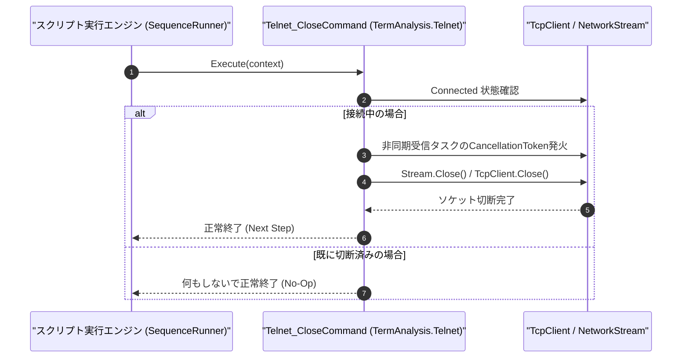

# コマンドリファレンス：Telnet_Close

## 概要

**Telnet_Close** は、現在接続されている Telnet（または Raw TCP ソケット）セッションの非同期受信ループを安全に停止し、`NetworkStream` および `TcpClient` ソケットを切断・解放するコマンドです。

> 💡 **補足**: シーケンス終了時に相手機器側の Telnet セッション枠（VTY ポート等）を残留させないため、通信完了後は必ず実行してください。

---

## 💡 書式・パラメータ仕様

### コマンド構文

```csv
,SEQUENCE, [ステップキー], Telnet_Close
```

### パラメータ（引数）一覧

| 引数位置 | パラメータ名 | 必須/任意 | 型・制約 | 説明 |
| :--- | :--- | :---: | :--- | :--- |
| （引数なし） | - | - | - | 現在接続中の Telnet / TCP ソケット回線を切断します。 |

---

## 🔄 特殊置換規約・分岐規約の適用

本コマンドの引数における特殊記法および解釈ルールです。
* **動的置換（`$`）**: 本コマンドは引数を取らないため、引数に対する `$PARAMキー$` 動的置換は適用されません。（適用可能な引数: 非適用）
* **ジャンプ先指定（`#`）**: 本コマンドはジャンプ制御を行わないため適用されません。（適用可能な引数: 非適用）
* **共通コマンド指定（`@`）**: 本コマンドは外部マクロを呼び出さないため、共通コマンド呼び出し記法は適用されません。（適用可能な引数: 非適用）
* **カンマのエスケープ**: 通信条件文字列（例: `"9600,E,7,1"`）や複数データのカンマ区切り値を単一引数として渡す場合は、必ず `"..."` と二重引用符で囲んで記述します。
* **エイリアス（別名）**: なし（標準コマンド名 `Telnet_Close` のみ。大文字・小文字は区別されません）

---

## 💡 動作例（正しい構文での記述例）

### スクリプト記述例

※COMMAND ブロック配下の子要素行（PARAM, SEQUENCE）は必ず行頭カンマから開始し、スペースインデントや行末コメント（`;`）は記述しないでください。

```csv
COMMAND, "SAMPLE_TELNET_CLOSE", ""
,SEQUENCE, 010, Telnet_Open
,SEQUENCE, 020, Telnet_WaitPrompt, "READY>", "5000"
,SEQUENCE, 030, Telnet_Send, "GET_VERSION"
,SEQUENCE, 040, Telnet_WaitPrompt, "READY>", "5000"
; 応答行を取り込んでからTelnetセッションを切断
,SEQUENCE, 050, Set_Data, "@VER_STR", "SBuf", "1"
,SEQUENCE, 060, Telnet_Close
,SEQUENCE, 070, Exit
```

### 実行時の挙動・変数変化

* **実行前の状態**: Term 通信エンジンが初期化され、必要な通信パラメータおよび変数プール（`PARAM`）が準備されている状態。
* **実行後の状態**: `Set_Data` により受信リングバッファからバージョン文字列が `@VER_STR` に格納されます。 `Telnet_Close` により TCP FIN パケットが送出され、ソケットリソースが解放されます。

---

## 🔄 動作フロー（シーケンス図）



---

## 🚫 エラーハンドリング・安全設計（仕様制限）

1. **未接続時の安全な無視（No-Op 保証）**:
   - すでにサーバー側から切断されている場合や未接続状態で `Telnet_Close` を実行した場合でも、例外を投げずに正常終了します。
2. **受信済みバッファの保持**:
   - ソケット切断後も `TermRingBufferManager` 内の受信済みデータは保持され、後続の `Set_Data` や `Get_Line` で抽出可能です。

---

## 🧪 ユニットテスト仕様

本コマンドクラス（`Telnet_CloseCommand.cs`）に実装されている `RunUnitTest()` メソッドが検証するユニットテストの仕様です。

### テスト実行前提条件

* **実行トリガー**: `RunUnitTest()` メソッドの呼び出し
* **有効化条件**: システム全体の最小ログレベル（`ErrorLogger.MinimumLevel`）が `LogLevel.Test` であること（それ以外の場合は無効化ガードにより早期リターン）
* **検証結果出力**: `_log.LogTest` によるログ出力。検証失敗時は `_log.LogError`、予期せぬ例外発生時は `_log.LogCritical` で記録し、`finally` ブロックで `SocketTransportCore.Shared.IsSimulationMode` を開始前の状態へ復元します。

### テストケース一覧

| No | テストカテゴリ | テスト条件（入力値） | 期待される結果（出力値） | 検証の目的 / 観点 |
| :---: | :--- | :--- | :--- | :--- |
| **1** | 正常系 | `SocketTransportCore.Shared.IsSimulationMode = true` 環境下で `OpenExclusiveSession(TermTransportDomain.Telnet, null, useSocket: true)` 確立後、引数なしで `Telnet_Close` を実行 | `!param.HasError` かつ `!SocketTransportCore.Shared.IsConnected`、`ActiveDomain == TermTransportDomain.None` となる | Telnet 排他セッションの正常切断およびソケット解放の検証 |
| **2** | 異常系 | 余剰引数の指定（`ValidateParamRange(0, 0)` 違反）または切断処理中の例外発生 | 引数範囲外エラー出力による早期リターン、または `_log.LogCritical` 記録と `SetErrorAndHalt(-1, ex.Message)` による安全停止 | 引数なし制約の境界検証およびソケット切断例外時のクラッシュ防御検証 |
