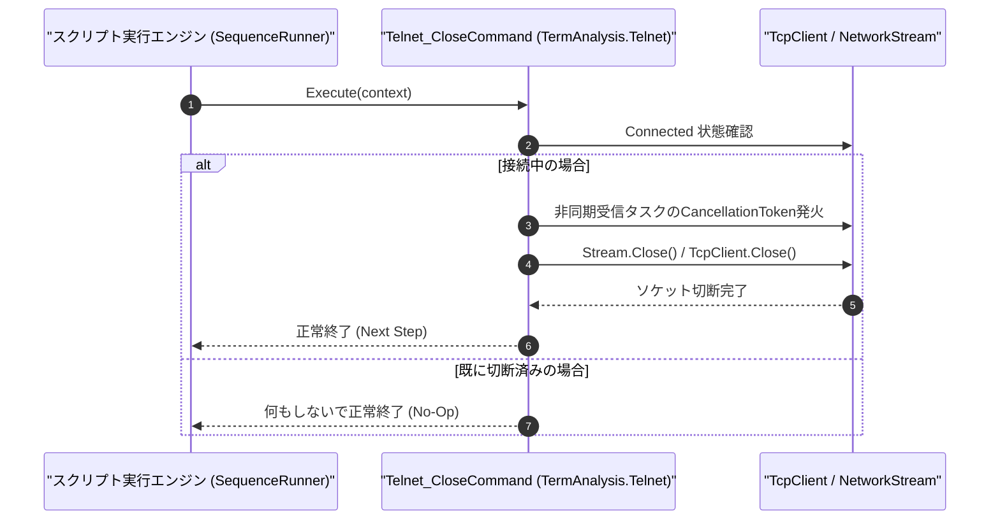

# コマンドリファレンス：Telnet_Close

---

## 概要

**Telnet_Close** は、現在接続されている Telnet（または Raw TCP ソケット）セッションの非同期受信ループを安全に停止し、`NetworkStream` および `TcpClient` ソケットを切断・解放するコマンドです。

> 💡 **補足**: シーケンス終了時に相手機器側の Telnet セッション枠（VTY ポート等）を残留させないため、通信完了後は必ず実行してください。

---

## 💡 書式・パラメータ仕様

### コマンド構文

```csv
,SEQUENCE,Telnet_Close
```

### パラメータ（引数）一覧

| 引数位置 | パラメータ名 | 必須/任意 | 型・制約 | 説明 |
| :--- | :--- | :---: | :--- | :--- |
| （引数なし） | - | - | - | 現在接続中の Telnet / TCP ソケット回線を切断します。 |

---

## 🔄 特殊置換規約・分岐規約の適用

1. **引数なしコマンド**:
   - 引数を取らないため、変数展開（`$` / `#` / `@`）は使用しません。
2. **大文字・小文字の非区別（Case-Insensitive）**:
   - `Telnet_Close`、`TELNET_CLOSE`、`telnet_close` のいずれも同一コマンドとして正規化されます。

---

## 💡 動作例（正しい構文での記述例）

### スクリプト記述例

```csv
,SEQUENCE,Telnet_Open
,SEQUENCE,Telnet_WaitPrompt, "READY>", "5000"
,SEQUENCE,Telnet_Send, "GET_VERSION"
,SEQUENCE,Telnet_WaitPrompt, "READY>", "5000"

; 応答行を取り込んでからTelnetセッションを切断
,SEQUENCE,Set_Data, "@VER_STR", "SBuf", "1"
,SEQUENCE,Telnet_Close
,SEQUENCE,Exit
```

### 実行時の挙動・変数変化

1. `Set_Data` により受信リングバッファからバージョン文字列が `@VER_STR` に格納されます。
2. `Telnet_Close` により TCP FIN パケットが送出され、ソケットリソースが解放されます。

---

## 🔄 動作フロー（シーケンス図）



---

## 🚫 エラーハンドリング・安全設計（仕様制限）

1. **未接続時の安全な無視（No-Op 保証）**:
   - すでにサーバー側から切断されている場合や未接続状態で `Telnet_Close` を実行した場合でも、例外を投げずに正常終了します。
2. **受信済みバッファの保持**:
   - ソケット切断後も `TermRingBufferManager` 内の受信済みデータは保持され、後続の `Set_Data` や `Get_Line` で抽出可能です。

---

## 🧪 ユニットテスト仕様

### テスト実行前提条件
- **対象クラス**: `TermAnalysis.Telnet.Telnet_CloseCommand`（`Telnet_CloseCommand.cs`）
- **モック環境**: `ITelnetClientAdapter` モックが注入されていること。

### テストケース一覧

| テストID | テスト観点 | 入力スクリプト | 期待される動作・検証項目 |
| :--- | :--- | :--- | :--- |
| `UT-TELNET-CLOSE-01` | 正常切断 | `,SEQUENCE,Telnet_Close`（接続中） | モックソケットの `Connected` が `false` になり、ストリームが破棄されること。 |
| `UT-TELNET-CLOSE-02` | 未接続時の再切断 | `,SEQUENCE,Telnet_Close`（未接続時） | 例外が発生せず正常終了すること。 |

