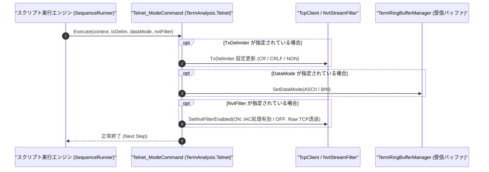

# コマンドリファレンス：Telnet_Mode

---

## 概要

**Telnet_Mode** は、Telnet（および Raw TCP ソケット）通信における送信デリミタ（`TXCR` / `TXCRLF` / `NON`）、受信データモード（`ASCII` / `BIN`）、および Telnet NVT 制御コード（IAC: `0xFF`）のフィルタ・自動ネゴシエーション応答の有効／無効（`ON` / `OFF`）を設定する統合モード制御コマンドです。

> 💡 **補足**: 第 3 引数 `NvtFilter` を `ON` にすると標準 Telnet サーバー（ルーターや Linux ホスト等）とのネゴシエーションを行い、`OFF` にすると `0xFF` を含む任意のバイナリフレームを透過させる Raw TCP ソケット通信として機能します。

---

## 💡 書式・パラメータ仕様

### コマンド構文

```csv
,SEQUENCE,Telnet_Mode, "[TxDelimiter]", "[DataMode]", "[NvtFilter: ON/OFF]"
```

### パラメータ（引数）一覧

| 引数位置 | パラメータ名 | 必須/任意 | 型・制約 | 説明 |
| :---: | :--- | :---: | :--- | :--- |
| 第1引数 | `TxDelimiter` | 任意 | `TXCR` / `TXCRLF` / `TXLF` / `NON` | `Telnet_Send` 等で自動付与する送信末改行コードを指定します。空文字 `""` または省略時は現在値を維持します。 |
| 第2引数 | `DataMode` | 任意 | `ASCII` / `BIN` | 受信リングバッファおよびログの解釈モード（テキスト行解析／バイナリストリーム）を指定します。 |
| 第3引数 | `NvtFilter` | 任意 | `ON` / `OFF`（既定値: `ON`） | Telnet NVT プロトコル（IAC `0xFF` 制御シーケンス）の分離・自動応答を行うか（`ON`）、Raw TCP ソケットとして全バイトをそのまま透過させるか（`OFF`）を指定します。 |

---

## 🔄 特殊置換規約・分岐規約の適用

1. **部分更新（省略または空文字 `""` の維持仕様）**:
   - 変更したい項目のみを指定し、他の引数を省略または `""` とすることで、既存のモード設定を維持したまま特定の属性だけを変更できます。
2. **変数展開（`$` / `@` / `#`）**:
   - 各引数には変数を指定可能です（例: `"$DELIM_MODE"`, `"$NVT_FLAG"`）。

---

## 💡 動作例（正しい構文での記述例）

### スクリプト記述例

```csv
; 1. 標準Telnet接続向け設定（CRLF改行、ASCIIモード、NVT IACフィルタ有効）
,SEQUENCE,Telnet_Mode, "TXCRLF", "ASCII", "ON"
,SEQUENCE,Telnet_Open
,SEQUENCE,Telnet_Close

; 2. Raw TCPソケット機器（バイナリプロトコル）向け設定（改行なし、BINモード、NVTフィルタ無効）
,SEQUENCE,Telnet_Mode, "NON", "BIN", "OFF"
,SEQUENCE,Telnet_Open
,SEQUENCE,Telnet_Send, "02 01 FF 03", "HEX"
,SEQUENCE,Telnet_Close
,SEQUENCE,Exit
```

### 実行時の挙動・変数変化

1. 1 回目の `Telnet_Mode` では標準 Telnet クライアントとして動作し、サーバーからの `IAC DO/WILL` ネゴシエーションを自動処理してテキストのみを受信バッファへ格納します。
2. 2 回目の `Telnet_Mode` では `NvtFilter` が `OFF` になるため、ペイロード内の `0xFF` バイトが Telnet 制御コードとして誤認・除去されることなく、そのまま Raw TCP ストリームとして送受信されます。

---

## 🔄 動作フロー（シーケンス図）



---

## 🚫 エラーハンドリング・安全設計（仕様制限）

1. **未定義キーワードの検証**:
   - `TxDelimiter` に `TXCR`/`TXCRLF`/`TXLF`/`NON` 以外、または `NvtFilter` に `ON`/`OFF`（`TRUE`/`FALSE`, `1`/`0` 含む）以外の不正な文字列が指定された場合は、`ArgumentException` を送出します。
2. **BIN モードと NVT フィルタの整合性保護**:
   - バイナリ通信時に `0xFF` が欠落する事故を防ぐため、`BIN` モード選択時には `NvtFilter` を `OFF` にすることが推奨されます。

---

## 🧪 ユニットテスト仕様

### テスト実行前提条件
- **対象クラス**: `TermAnalysis.Telnet.Telnet_ModeCommand`（`Telnet_ModeCommand.cs`）
- **モック環境**: `ITelnetClientAdapter` モックおよび `TermRingBufferManager` が注入されていること。

### テストケース一覧

| テストID | テスト観点 | 入力スクリプト | 期待される動作・検証項目 |
| :--- | :--- | :--- | :--- |
| `UT-TELNET-MODE-01` | 標準Telnet設定 | `,SEQUENCE,Telnet_Mode, "TXCRLF", "ASCII", "ON"` | デリミタ `CRLF`、データモード `ASCII`、NVT フィルタ `ON` が設定されること。 |
| `UT-TELNET-MODE-02` | Raw TCPソケット設定 | `,SEQUENCE,Telnet_Mode, "NON", "BIN", "OFF"` | デリミタなし、データモード `BIN`、NVT フィルタ `OFF`（`0xFF` 透過）が設定されること。 |
| `UT-TELNET-MODE-03` | 異常系（不正キーワード） | `,SEQUENCE,Telnet_Mode, "INVALID_DELIM"` | `ArgumentException` が送出され、エラーログが出力されること。 |

