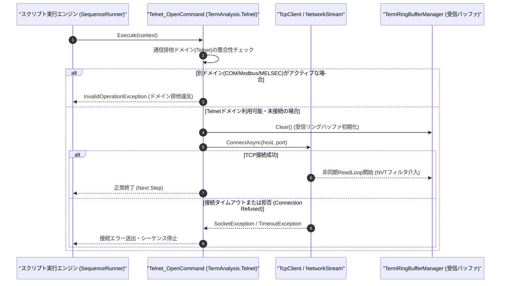

# コマンドリファレンス：Telnet_Open

---

## 概要

**Telnet_Open** は、Term アプリケーションの UI 画面または環境設定であらかじめ指定された接続先 IP アドレス・TCP ポート番号に対して Telnet（または Raw TCP ソケット）接続を確立し、非同期受信監視スレッドおよび受信リングバッファ（`TermRingBufferManager`）の稼働を開始するコマンドです。
実行時に Term 通信制御の排他選択モードを **Telnet（TCP ソケット）モード**（`TermAnalysis.Telnet.dll`）へ確定させます。

> 💡 **補足**: `Telnet_Mode` の NVT フィルタ設定により、標準 Telnet ネゴシエーション（IAC `0xFF`）対応モードと Raw TCP ソケット透過モードの双方を単一アーキテクチャで制御できます。

---

## 💡 書式・パラメータ仕様

### コマンド構文

```csv
,SEQUENCE,Telnet_Open
```

### パラメータ（引数）一覧

| 引数位置 | パラメータ名 | 必須/任意 | 型・制約 | 説明 |
| :--- | :--- | :---: | :--- | :--- |
| （引数なし） | - | - | - | UI 上で設定されている接続先ホスト（IP アドレス／ホスト名）および TCP ポート番号へ接続します。 |

---

## 🔄 特殊置換規約・分岐規約の適用

1. **引数なしコマンド**:
   - 引数を取らないため、変数展開（`$` / `#` / `@`）は使用しません。
2. **大文字・小文字の非区別（Case-Insensitive）**:
   - `Telnet_Open`、`TELNET_OPEN`、`telnet_open` のいずれも同一コマンドとして正規化されます。
3. **レガシー別名互換**:
   - 旧表記の `Telnet_Open` も同一キーへ正規化されます。

---

## 💡 動作例（正しい構文での記述例）

### スクリプト記述例

```csv
; 1. 送信デリミタCRLF・ASCIIモード・NVTフィルタONを設定してTelnet接続
,SEQUENCE,Telnet_Mode, "TXCRLF", "ASCII", "ON"
,SEQUENCE,Telnet_Open

; 2. ログインプロンプトを待機してユーザー名・パスワードを送信
,SEQUENCE,Telnet_WaitPrompt, "login:", "5000", "CONN_ERR"
,SEQUENCE,Telnet_Send, "admin"
,SEQUENCE,Telnet_WaitPrompt, "Password:", "5000", "CONN_ERR"
,SEQUENCE,Telnet_Send, "secret123"
,SEQUENCE,Telnet_WaitPrompt, "#", "5000", "CONN_ERR"
,SEQUENCE,Exit
```

### 実行時の挙動・変数変化

1. `Telnet_Mode` により改行 `CR+LF`、ASCII 解析、NVT IAC ネゴシエーション自動応答が有効化されます。
2. `Telnet_Open` により TCP 3 ウェイハンドシェイクが行われ、接続確立後に `TermRingBufferManager` への非同期ストリーム読み取りが開始されます。

---

## 🔄 動作フロー（シーケンス図）



---

## 🚫 エラーハンドリング・安全設計（仕様制限）

1. **接続タイムアウト保護**:
   - 対象ホストが応答しない場合、OS 無限待機に陥らないよう接続タイムアウト（既定 5,000ms）で `SocketException` / `TimeoutException` を発生させて停止します。
2. **他通信ドメインとの排他保護**:
   - 同一シーケンス内で `Com_Open` 等と併用された場合は、排他制御エラーとして即座に検出・遮断します。

---

## 🧪 ユニットテスト仕様

### テスト実行前提条件
- **対象クラス**: `TermAnalysis.Telnet.Telnet_OpenCommand`（`Telnet_OpenCommand.cs`）
- **モック環境**: ローカルループバック TCP リスナーまたは `ITelnetClientAdapter` モックが構成されていること。

### テストケース一覧

| テストID | テスト観点 | 入力スクリプト | 期待される動作・検証項目 |
| :--- | :--- | :--- | :--- |
| `UT-TELNET-OPEN-01` | 正常接続 | `,SEQUENCE,Telnet_Open` | TCP ソケットが接続状態になり、受信リングバッファ監視が開始されること。 |
| `UT-TELNET-OPEN-02` | 大文字小文字非区別 | `,SEQUENCE,telnet_open` | `Telnet_OpenCommand` が正常に呼び出されること。 |
| `UT-TELNET-OPEN-03` | 異常系（接続拒否） | `,SEQUENCE,Telnet_Open`（サーバ停止時） | `SocketException` が捕捉され、エラーログを出力して停止すること。 |

