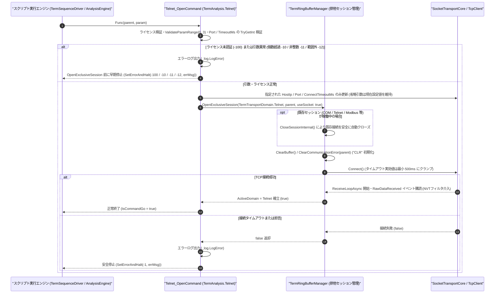

# コマンドリファレンス：Telnet_Open

## 概要

**Telnet_Open** は、Term アプリケーションの UI 画面または環境設定であらかじめ指定された接続先 IP アドレス・TCP ポート番号に対して Telnet（または Raw TCP ソケット）接続を確立し、非同期受信監視スレッドおよび受信リングバッファ（`TermRingBufferManager`）の稼働を開始するコマンドです。
実行時に Term 通信制御の排他選択モードを **Telnet（TCP ソケット）モード** （`TermAnalysis.Telnet.dll`）へ確定させます。

> 💡 **補足** : `Telnet_Mode` の NVT フィルタ設定により、標準 Telnet ネゴシエーション（IAC `0xFF`）対応モードと Raw TCP ソケット透過モードの双方を単一アーキテクチャで制御できます。

---

## 💡 書式・パラメータ仕様

### コマンド構文

```csv
,SEQUENCE, [ステップキー], Telnet_Open, "[HostIp]", "[Port: 23]", "[TimeoutMs: 5000]"
```

※ 全引数を省略した場合は、UI「TELNET」プロパティタブ（`TermPropertiesTelnet` の読込・保存時に `SocketTransportCore.Shared` へ同期）または直前の `Telnet_Mode` で設定されている `SocketTransportCore.Shared` の現在設定値を使用して接続します。

### パラメータ（引数）一覧

| 引数位置 | 引数名 | 必須/任意 | 説明・制約 |
| :--- | :--- | :---: | :--- |
| 第 1 引数 | `HostIp` | 任意 | 接続先ホスト名または IPv4 アドレス（例: `"192.168.1.100"`。省略または空文字 `""` 指定時は `SocketTransportCore.Shared.Host` の現在設定値［初期既定 `"127.0.0.1"`、UI 設定読込・保存後は UI 設定値］を使用）。 |
| 第 2 引数 | `Port` | 任意 | 接続先 TCP ポート番号（`1`〜`65535`。引数省略時は `SocketTransportCore.Shared.Port` の現在設定値［初期既定 `23`、UI 設定読込・保存後は UI 設定値］を維持。第 2 引数を空文字 `""` で明示渡した場合のみ `23`）。 |
| 第 3 引数 | `TimeoutMs` | 任意 | TCP 接続確立タイムアウト時間［ミリ秒］（許容入力範囲: `100` 以上の整数。引数省略時は `SocketTransportCore.Shared.ConnectTimeoutMs` の現在設定値［初期既定 `3000` ms、UI 設定読込・保存後は `Math.Max(500, ConnectTimeoutSec * 1000)`］を維持し、第 3 引数を空文字 `""` で明示渡した場合のみ `5000` ms。なお実接続時は `SocketTransportCore.Connect` 内部で最小 **`500` ms** にクランプされます）。 |

---

## 🔄 特殊置換規約・分岐規約の適用

本コマンドの引数における特殊記法および解釈ルールです。
* **動的置換（`$`）** : 引数内で `$PARAMキー$` のように記述すると、実行時に変数プール（PARAM）の値へ動的置換されます。（適用可能な引数: 全引数対応）
* **ジャンプ先指定（`#`）** : 本コマンドはジャンプ制御を行わないため適用されません。（適用可能な引数: 非適用）
* **共通コマンド指定（`@`）** : 本コマンドは外部マクロを呼び出さないため、共通コマンド呼び出し記法は適用されません。（適用可能な引数: 非適用）
* **カンマのエスケープ** : 通信条件文字列（例: `"9600,E,7,1"`）や複数データのカンマ区切り値を単一引数として渡す場合は、必ず `"..."` と二重引用符で囲んで記述します。
* **エイリアス（別名）** : なし（標準コマンド名 `Telnet_Open` のみ。大文字・小文字は区別されません）

---

## 💡 動作例（正しい構文での記述例）

### スクリプト記述例

※COMMAND ブロック配下の子要素行（PARAM, SEQUENCE）は必ず行頭カンマから開始し、スペースインデントや行末コメント（`;`）は記述しないでください。

```csv
COMMAND, "SAMPLE_TELNET_OPEN", ""
; 1. 送信デリミタCRLF・ASCIIモード・NVTフィルタONを設定してTelnet接続
,SEQUENCE, 010, Telnet_Mode, "TXCRLF", "ASCII", "ON"
,SEQUENCE, 020, Telnet_Open
; 2. ログインプロンプトを待機してユーザー名・パスワードを送信
,SEQUENCE, 030, Telnet_WaitPrompt, "login:", "5000", #CONN_ERR#
,SEQUENCE, 040, Telnet_Send, "admin"
,SEQUENCE, 050, Telnet_WaitPrompt, "Password:", "5000", #CONN_ERR#
,SEQUENCE, 060, Telnet_Send, "secret123"
,SEQUENCE, 070, Telnet_WaitPrompt, "#", "5000", #CONN_ERR#
,SEQUENCE, 080, Telnet_Close
,SEQUENCE, 090, Exit
; 接続・認証タイムアウト時の異常系クローズ処理
,SEQUENCE, #CONN_ERR#, Msg_Box, "Telnetログイン応答がタイムアウトしました"
,SEQUENCE, 100, Telnet_Close
,SEQUENCE, 110, Exit
```

### 実行時の挙動・変数変化

* **実行前の状態** : Term 通信エンジンが初期化され、必要な通信パラメータおよび変数プール（`PARAM`）が準備されている状態。
* **実行後の状態** : `Telnet_Mode` により改行 `CR+LF`、ASCII 解析、NVT IAC ネゴシエーション自動応答が有効化されます。 `Telnet_Open` により既存の通信セッションがある場合は自動クローズされた上で TCP 接続が行われ、接続確立後に受信リングバッファ（`TermRingBufferManager`）のクリア・通信エラーフラグ（`"CLR"`）初期化・非同期ストリーム受信購読が開始されます。

---

## 🔄 動作フロー（シーケンス図）



---

## 🚫 エラーハンドリング・安全設計（仕様制限）

1. **引数境界保護・ライセンス検証と接続タイムアウト時の安全停止** :
   - `Telnet` エクステンションライセンス未認証時はエラーコード **`-100`** 、引数個数超過（4 個以上）時は **`-10`** 、`Port` や `TimeoutMs` に非整数文字列が指定された場合は **`-11`** 、許容範囲外（`Port < 1 || Port > 65535` または `TimeoutMs < 100`）が指定された場合は **`-12`** を設定し、既存セッションを切断する前に早期安全停止します。また、対象ホスト無応答（タイムアウト実効値は最小 `500` ms にクランプ）や接続拒否時にはエラーログを出力し、`SetErrorAndHalt(-1, errMsg)` によりシーケンスを安全に停止します。
2. **UI 設定同期および他通信ドメインからの安全な自動切替（`OpenExclusiveSession`）** :
   - UI「TELNET」タブの読込・保存時に `SocketTransportCore.Shared`（`Host`, `Port`, `ConnectTimeoutMs`）が自動同期されるため、引数を省略した場合はその現在設定値を維持して接続します。また、すでに `Com_Open` や `Modbus_Open` 等の他ドメインセッション、または既存の Telnet セッションが稼働している場合は、既存セッションを内部で安全に自動クローズしてから新しい Telnet セッションへ排他切り替えします。

---

## 🧪 ユニットテスト仕様

本コマンドクラス（`Telnet_OpenCommand.cs`）に実装されている `RunUnitTest()` メソッドが検証するユニットテストの仕様です。

### テスト実行前提条件

* **実行トリガー** : `RunUnitTest()` メソッドの呼び出し
* **有効化条件** : システム全体の最小ログレベル（`ErrorLogger.MinimumLevel`）が `LogLevel.Test` であること（それ以外の場合は無効化ガードにより早期リターン）
* **検証結果出力** : `_log.LogTest` によるログ出力。検証失敗時は `_log.LogError`、予期せぬ例外発生時は `_log.LogCritical` で記録し、`finally` ブロックで `TermRingBufferManager.Instance.CloseSession(TermTransportDomain.Telnet, null)` および `SocketTransportCore.Shared.IsSimulationMode` の復元を実行します。

### テストケース一覧

| No | テストカテゴリ | テスト条件（入力値） | 期待される結果（出力値） | 検証の目的 / 観点 |
| :---: | :--- | :--- | :--- | :--- |
| **1** | 正常系 | `SocketTransportCore.Shared.IsSimulationMode = true` 環境下で引数 `"192.168.1.50"`, `"23"`, `"3000"` を指定して実行 | `!param.HasError` かつ `IsConnected == true`、`ActiveDomain == TermTransportDomain.Telnet`、`Host == "192.168.1.50"`、`Port == 23` となる | ホスト IP・TCP ポート・接続タイムアウト指定による Telnet 排他セッション確立の検証 |
| **2** | 異常系 | 過剰引数 4 個（`"192.168.1.50"`, `"23"`, `"3000"`, `"EXTRA_INVALID"`）を指定して `Func(null, invalidParam)` を実行（`ValidateParamRange(0, 3)` 違反） | `invalidParam.HasError == true` かつ `!invalidParam.IsCommandGo` で安全に実行拒否・停止する | 引数上限（最大 3 個）の境界ガード検証 |
