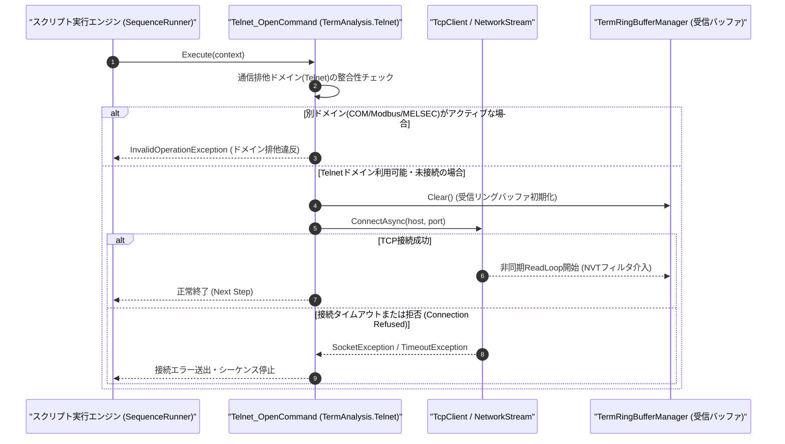

# コマンドリファレンス：Telnet_Open

## 概要

**Telnet_Open** は、Term アプリケーションの UI 画面または環境設定であらかじめ指定された接続先 IP アドレス・TCP ポート番号に対して Telnet（または Raw TCP ソケット）接続を確立し、非同期受信監視スレッドおよび受信リングバッファ（`TermRingBufferManager`）の稼働を開始するコマンドです。
実行時に Term 通信制御の排他選択モードを **Telnet（TCP ソケット）モード** （`TermAnalysis.Telnet.dll`）へ確定させます。

> 💡 **補足**: `Telnet_Mode` の NVT フィルタ設定により、標準 Telnet ネゴシエーション（IAC `0xFF`）対応モードと Raw TCP ソケット透過モードの双方を単一アーキテクチャで制御できます。

---

## 💡 書式・パラメータ仕様

### コマンド構文

```csv
,SEQUENCE, [ステップキー], Telnet_Open, "[HostIp]", "[Port: 23]", "[TimeoutMs: 5000]"
```

※ 全引数を省略した場合は、UI プロパティ画面で設定されている接続先ホストおよび TCP ポート番号へ接続します。

### パラメータ（引数）一覧

| 引数位置 | 引数名 | 必須/任意 | 説明・制約 |
| :--- | :--- | :---: | :--- |
| 第 1 引数 | `HostIp` | 任意 | 接続先ホスト名または IPv4 アドレス（例: `"192.168.1.100"`、省略時既定値: `""`＝UI 設定値を使用）。 |
| 第 2 引数 | `Port` | 任意 | 接続先 TCP ポート番号（`1`〜`65535`、省略時既定値: `23`）。 |
| 第 3 引数 | `TimeoutMs` | 任意 | TCP 接続確立タイムアウト時間［ミリ秒］（省略時既定値: `5000`）。 |

---

## 🔄 特殊置換規約・分岐規約の適用

本コマンドの引数における特殊記法および解釈ルールです。
* **動的置換（`$`）**: 引数内で `$PARAMキー$` のように記述すると、実行時に変数プール（PARAM）の値へ動的置換されます。（適用可能な引数: 全引数対応）
* **ジャンプ先指定（`#`）**: 本コマンドはジャンプ制御を行わないため適用されません。（適用可能な引数: 非適用）
* **共通コマンド指定（`@`）**: 本コマンドは外部マクロを呼び出さないため、共通コマンド呼び出し記法は適用されません。（適用可能な引数: 非適用）
* **カンマのエスケープ**: 通信条件文字列（例: `"9600,E,7,1"`）や複数データのカンマ区切り値を単一引数として渡す場合は、必ず `"..."` と二重引用符で囲んで記述します。
* **エイリアス（別名）**: なし（標準コマンド名 `Telnet_Open` のみ。大文字・小文字は区別されません）

---

## 💡 動作例（正しい構文での記述例）

### スクリプト記述例

※COMMAND ブロック配下の子要素行（PARAM, SEQUENCE）は必ず行頭カンマから開始し、スペースインデントや行末コメント（`;`）は記述しないでください。

```csv
COMMAND, "SAMPLE_TELNET_OPEN", ""
; 1. 送信デリミタCRLF・ASCIIモード・NVTフィルタONを設定してTelnet接続
,SEQUENCE, 010, Telnet_Mode, "TXCRLF", "ASCII", "ON"
,SEQUENCE, 020, Telnet_Open
; 2. ログインプロンプトを待機してユーザー名・パスワードを送信
,SEQUENCE, 030, Telnet_WaitPrompt, "login:", "5000", "CONN_ERR"
,SEQUENCE, 040, Telnet_Send, "admin"
,SEQUENCE, 050, Telnet_WaitPrompt, "Password:", "5000", "CONN_ERR"
,SEQUENCE, 060, Telnet_Send, "secret123"
,SEQUENCE, 070, Telnet_WaitPrompt, "#", "5000", "CONN_ERR"
,SEQUENCE, 080, Exit
```

### 実行時の挙動・変数変化

* **実行前の状態**: Term 通信エンジンが初期化され、必要な通信パラメータおよび変数プール（`PARAM`）が準備されている状態。
* **実行後の状態**: `Telnet_Mode` により改行 `CR+LF`、ASCII 解析、NVT IAC ネゴシエーション自動応答が有効化されます。 `Telnet_Open` により TCP 3 ウェイハンドシェイクが行われ、接続確立後に `TermRingBufferManager` への非同期ストリーム読み取りが開始されます。

---

## 🔄 動作フロー（シーケンス図）



---

## 🚫 エラーハンドリング・安全設計（仕様制限）

1. **接続タイムアウト保護**:
   - 対象ホストが応答しない場合、OS 無限待機に陥らないよう接続タイムアウト（既定 5,000ms）で `SocketException` / `TimeoutException` を発生させて停止します。
2. **他通信ドメインとの排他保護**:
   - 同一シーケンス内で `Com_Open` 等と併用された場合は、排他制御エラーとして即座に検出・遮断します。

---

## 🧪 ユニットテスト仕様

本コマンドクラス（`Telnet_OpenCommand.cs`）に実装されている `RunUnitTest()` メソッドが検証するユニットテストの仕様です。

### テスト実行前提条件

* **実行トリガー**: `RunUnitTest()` メソッドの呼び出し
* **有効化条件**: システム全体の最小ログレベル（`ErrorLogger.MinimumLevel`）が `LogLevel.Test` であること（それ以外の場合は無効化ガードにより早期リターン）
* **検証結果出力**: `_log.LogTest` によるログ出力。検証失敗時は `_log.LogError`、予期せぬ例外発生時は `_log.LogCritical` で記録し、`finally` ブロックで `TermRingBufferManager.Instance.CloseSession(TermTransportDomain.Telnet, null)` および `SocketTransportCore.Shared.IsSimulationMode` の復元を実行します。

### テストケース一覧

| No | テストカテゴリ | テスト条件（入力値） | 期待される結果（出力値） | 検証の目的 / 観点 |
| :---: | :--- | :--- | :--- | :--- |
| **1** | 正常系 | `SocketTransportCore.Shared.IsSimulationMode = true` 環境下で引数 `"192.168.1.50"`, `"23"`, `"3000"` を指定して実行 | `!param.HasError` かつ `IsConnected == true`、`ActiveDomain == TermTransportDomain.Telnet`、`Host == "192.168.1.50"`、`Port == 23` となる | ホスト IP・TCP ポート・接続タイムアウト指定による Telnet 排他セッション確立の検証 |
| **2** | 異常系 | ポート範囲外（`1`〜`65535` 外）・タイムアウト範囲外（`100` 未満）・引数 4 個以上の指定（`ValidateParamRange(0, 3)` 違反）、または接続失敗 | `_log.LogError` 出力および `SetErrorAndHalt(-1, errMsg)`（または引数検証失敗による早期リターン）により安全に停止する | ポート／タイムアウト境界値検証およびソケット接続失敗時のフェイルセーフ検証 |
