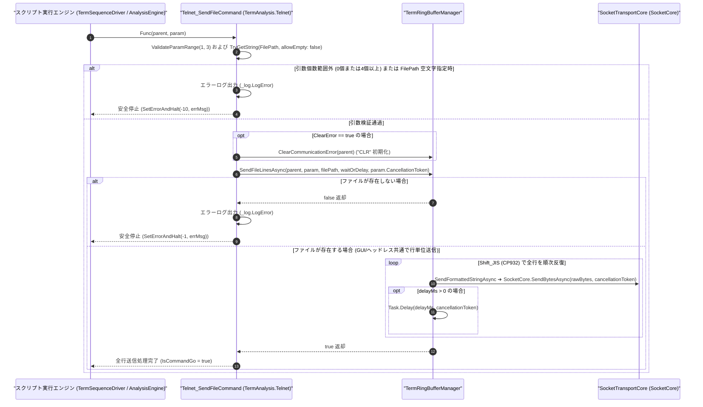

# コマンドリファレンス：Telnet_SendFile

## 概要

**Telnet_SendFile** は、指定されたテキストファイル（Shift_JIS / CP932）の内容を 1 行ずつ読み込み、接続中の Telnet（または Raw TCP ソケット）ストリームへ逐次送信するコマンドです。
第 2 引数に行間ウェイト時間（ミリ秒の正整数）を指定することで、相手機器の受信バッファ溢れやコマンド取りこぼしを防ぎながら安全にバッチ投入できます。

> 💡 **補足** : ネットワークスイッチや測定器へのコンフィグファイル一括流し込みに最適です。なお、本コマンドは行間のプロンプト文字列到着待機は行わないため、1 コマンドごとにプロンプト応答確認が必要な場合は `Telnet_Send` と `Telnet_WaitPrompt` を組み合わせて使用してください。

---

## 💡 書式・パラメータ仕様

### コマンド構文

```csv
,SEQUENCE, [ステップキー], Telnet_SendFile, [FilePath], "[DelayMsOrDialogMode: WaitPrompt]", "[ClearError: false]"
```

### パラメータ（引数）一覧

| 引数位置 | 引数名 | 必須/任意 | 説明・制約 |
| :--- | :--- | :---: | :--- |
| 第 1 引数 | `FilePath` | **必須** | 送信するテキストファイルのパス（相対パスまたは絶対パス。空文字不可）。 |
| 第 2 引数 | `WaitPromptOrDelayMs` | 任意 | **正の整数文字列（例: `"50"`, `"100"`）を指定した場合は 1 行送信ごとの行間待機時間［ミリ秒］** として動作します。`"NP"` / `"false"` / `"0"` または省略時（既定値 `"WaitPrompt"`）は行間ディレイなしで全行を連続送信します（※Telnet ドメインでは GUI 接続時でもシリアル送信ダイアログへは分岐せず、常に `SocketCore.SendBytesAsync` で行単位送信します。またプロンプト文字列による行間応答待機は行いません）。 |
| 第 3 引数 | `ClearError` | 任意 | 送信開始前に既存の通信エラー状態を `"CLR"` にクリアするかを示す真偽値（`"true"` / `"1"` でクリア実行、省略時既定値: `false`）。 |

---

## 🔄 特殊置換規約・分岐規約の適用

本コマンドの引数における特殊記法および解釈ルールです。
* **動的置換（`$`）** : 引数内で `$PARAMキー$` のように記述すると、実行時に変数プール（PARAM）の値へ動的置換されます。（適用可能な引数: 全引数対応）
* **ジャンプ先指定（`#`）** : 本コマンドはジャンプ制御を行わないため適用されません。（適用可能な引数: 非適用）
* **共通コマンド指定（`@`）** : 本コマンドは外部マクロを呼び出さないため、共通コマンド呼び出し記法は適用されません。（適用可能な引数: 非適用）
* **カンマのエスケープ** : 通信条件文字列（例: `"9600,E,7,1"`）や複数データのカンマ区切り値を単一引数として渡す場合は、必ず `"..."` と二重引用符で囲んで記述します。
* **エイリアス（別名）** : なし（標準コマンド名 `Telnet_SendFile` のみ。大文字・小文字は区別されません）

---

## 💡 動作例（正しい構文での記述例）

### スクリプト記述例

※COMMAND ブロック配下の子要素行（PARAM, SEQUENCE）は必ず行頭カンマから開始し、スペースインデントや行末コメント（`;`）は記述しないでください。

```csv
COMMAND, "SAMPLE_TELNET_SENDFILE", ""
,PARAM, "SCRIPT_PATH", Text, "スクリプトパス", ".\scripts\switch_vlan_setup.txt"
,SEQUENCE, 010, Telnet_Open
,SEQUENCE, 020, Telnet_WaitPrompt, "Switch#", "5000"
; 1行ごとに 100ms のディレイを挟みながら設定ファイルを逐次送信し、完了後にプロンプトを確認
,SEQUENCE, 030, Telnet_SendFile, "$SCRIPT_PATH$", "100", "true"
,SEQUENCE, 040, Telnet_WaitPrompt, "Switch#", "5000"
,SEQUENCE, 050, Telnet_Close
,SEQUENCE, 060, Exit
```

### 実行時の挙動・変数変化

* **実行前の状態** : Term 通信エンジンが初期化され、必要な通信パラメータおよび変数プール（`PARAM`）が準備されている状態。
* **実行後の状態** : 通信エラー状態が `"CLR"` にリセットされた後、`.\scripts\switch_vlan_setup.txt` の各行が順番に読み込まれ、1 行送信するごとに `100` ms のインターバル（`Task.Delay`）を挟みながら TCP ソケットへ送出されます。全行送信後に `Telnet_WaitPrompt` で `"Switch#"` プロンプトの復帰を確認して切断します。

---

## 🔄 動作フロー（シーケンス図）



---

## 🚫 エラーハンドリング・安全設計（仕様制限）

1. **必須引数欠落・空文字エラー（`-10`）およびファイル不在エラー（`-1`）の安全停止と下位送信仕様** :
   - 引数個数範囲外（0 個または 4 個以上：`ValidateParamRange(1, 3)` 違反）または第 1 引数 `FilePath` に空白・空文字が指定された場合はエラーログを出力し、エラーコード **`-10`** （`SetErrorAndHalt(-10, errMsg)`）で早期安全停止します。また指定されたファイルが存在しない場合は `SendFileLinesAsync` が `false` を返し、エラーコード **`-1`** （`SetErrorAndHalt(-1, errMsg)`）で安全に停止します。なお、Telnet ドメイン（`ActiveDomain == TermTransportDomain.Telnet`）では GUI 接続時も含めて `SocketCore.SendBytesAsync` による行単位送信を行い、ファイル実在時に下位ソケット未接続等で `SendBytesAsync` が `false` を返した場合はエラー停止せず通過（`IsCommandGo = true`）します。
2. **キャンセル要求および送信中例外発生時のフェイルセーフ** :
   - 行間ディレイ（`delayMs`）を伴う長大なファイル送信中にユーザーが停止操作を行った場合や通信例外が発生した場合は、`CancellationToken` により送信ループを即座に中断し、`_log.LogCritical` を記録の上エラーコード `-1`（`SetErrorAndHalt(-1, ex.Message)`）で安全に停止します。

---

## 🧪 ユニットテスト仕様

本コマンドクラス（`Telnet_SendFileCommand.cs`）に実装されている `RunUnitTest()` メソッドが検証するユニットテストの仕様です。

### テスト実行前提条件

* **実行トリガー** : `RunUnitTest()` メソッドの呼び出し
* **有効化条件** : システム全体の最小ログレベル（`ErrorLogger.MinimumLevel`）が `LogLevel.Test` であること（それ以外の場合は無効化ガードにより早期リターン）
* **検証結果出力** : `_log.LogTest` によるログ出力。検証失敗時は `_log.LogError`、予期せぬ例外発生時は `_log.LogCritical` で記録し、`finally` ブロックでテスト用一時ファイル（`tempFile`）の削除、`TermRingBufferManager.Instance.CloseSession(TermTransportDomain.Telnet, null)`、および `SocketTransportCore.Shared.IsSimulationMode` の復元を実行します。

### テストケース一覧

| No | テストカテゴリ | テスト条件（入力値） | 期待される結果（出力値） | 検証の目的 / 観点 |
| :---: | :--- | :--- | :--- | :--- |
| **1** | 正常系 | 一時ファイル `Telnet_SendFile_Test_<GUID>.txt`（内容 `"ls -la\r\npwd\r\n"`）を生成し、`IsSimulationMode = true` で Telnet セッション確立後、引数 `tempFile`, `"NP"`, `"true"` を指定して実行 | `!param.HasError` かつ `param.IsCommandGo == true` で全行送信が正常完了する | エラークリア指定およびプロンプト待機なし（`"NP"`）でのテキストファイル逐次送信の検証 |
| **2** | 異常系 | 必須引数 `FilePath` を省略（引数 0 個）して `Func(null, invalidParam)` を実行（`ValidateParamRange(1, 3)` 違反） | `invalidParam.HasError == true` かつ `!invalidParam.IsCommandGo` で未送信のまま安全に実行拒否・停止する | 必須ファイルパス欠落時の境界ガード検証 |
