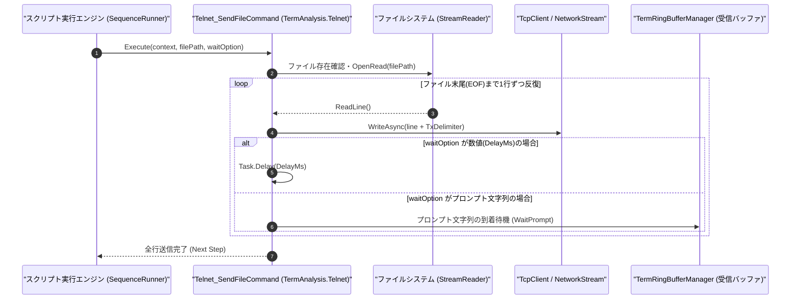

# コマンドリファレンス：Telnet_SendFile

---

## 概要

**Telnet_SendFile** は、指定されたテキストファイルの内容を 1 行ずつ読み込み、接続中の Telnet（または Raw TCP ソケット）ストリームへ逐次送信するコマンドです。
第 2 引数に行間ウェイト時間（ミリ秒）またはプロンプト文字列を指定することで、ネットワーク機器のコマンド解釈完了を待ちながら安全にバッチ投入できます。

> 💡 **補足**: ネットワークスイッチや測定器へのコンフィグファイル一括流し込みに最適です。

---

## 💡 書式・パラメータ仕様

### コマンド構文

```csv
,SEQUENCE,Telnet_SendFile, "<FilePath>", "[WaitPrompt/DelayMs]"
```

### パラメータ（引数）一覧

| 引数位置 | パラメータ名 | 必須/任意 | 型・制約 | 説明 |
| :---: | :--- | :---: | :--- | :--- |
| 第1引数 | `FilePath` | **必須** | 文字列（ファイルパス） | 送信するテキストファイルのパス（相対パスまたは絶対パス）を指定します。 |
| 第2引数 | `WaitPrompt/DelayMs` | 任意 | 数値文字列 または プロンプト文字列（既定値: `"0"`） | ・数値（例: `"50"`）を指定した場合：1行送信ごとに指定ミリ秒待機します。<br>・文字列（例: `"#"`）を指定した場合：1行送信ごとにそのプロンプトが受信されるまで待機します。 |

---

## 🔄 特殊置換規約・分岐規約の適用

1. **ファイルパスおよび待機条件の変数展開**:
   - 第 1 引数・第 2 引数ともに `$` / `@` / `#` による変数展開が適用されます。
2. **送信デリミタの自動適用**:
   - ファイル内の各行に対して、`Telnet_Mode` で設定されている送信デリミタ（`TXCR` / `TXCRLF` / `NON`）が付与されて送信されます。

---

## 💡 動作例（正しい構文での記述例）

### スクリプト記述例

```csv
,PARAM,SCRIPT_PATH,.\scripts\switch_vlan_setup.txt

,SEQUENCE,Telnet_Open
,SEQUENCE,Telnet_WaitPrompt, "Switch#", "5000"

; 1行送信ごとに "Switch#" プロンプトの返却を確認しながら設定ファイルを送信
,SEQUENCE,Telnet_SendFile, "$SCRIPT_PATH", "Switch#"
,SEQUENCE,Telnet_Close
,SEQUENCE,Exit
```

### 実行時の挙動・変数変化

1. `.\scripts\switch_vlan_setup.txt` の各行が順番に読み込まれます。
2. 1 行送信するごとに受信リングバッファ（`TermRingBufferManager`）に `"Switch#"` が到着するのを待ち、確認後に次の行を送信します。

---

## 🔄 動作フロー（シーケンス図）



---

## 🚫 エラーハンドリング・安全設計（仕様制限）

1. **ファイル不在時の事前チェック**:
   - 指定されたファイルが存在しない場合は、送信を開始する前に `FileNotFoundException` を送出してシーケンスを停止します。
2. **プロンプト待機タイムアウト防止**:
   - 第 2 引数にプロンプト文字列を指定した際、規定時間（既定 10,000ms）以内に応答がない場合はタイムアウト例外を送出し、無限待機を防止します。

---

## 🧪 ユニットテスト仕様

### テスト実行前提条件
- **対象クラス**: `TermAnalysis.Telnet.Telnet_SendFileCommand`（`Telnet_SendFileCommand.cs`）
- **モック環境**: テスト用一時ファイルおよび `ITelnetClientAdapter` モックが準備されていること。

### テストケース一覧

| テストID | テスト観点 | 入力スクリプト | 期待される動作・検証項目 |
| :--- | :--- | :--- | :--- |
| `UT-TELNET-SENDFILE-01` | 正常系（行間ディレイ送信） | `,SEQUENCE,Telnet_SendFile, "cmds.txt", "20"` | ファイル内の全行が 20ms 間隔で順番に送信されること。 |
| `UT-TELNET-SENDFILE-02` | 正常系（プロンプト同期送信） | `,SEQUENCE,Telnet_SendFile, "cmds.txt", "#"` | 各行送信後に `"#"` の受信を確認してから次行が送信されること。 |
| `UT-TELNET-SENDFILE-03` | 異常系（ファイル不在） | `,SEQUENCE,Telnet_SendFile, "missing.txt"` | `FileNotFoundException` が発生し、エラーログが出力されること。 |

