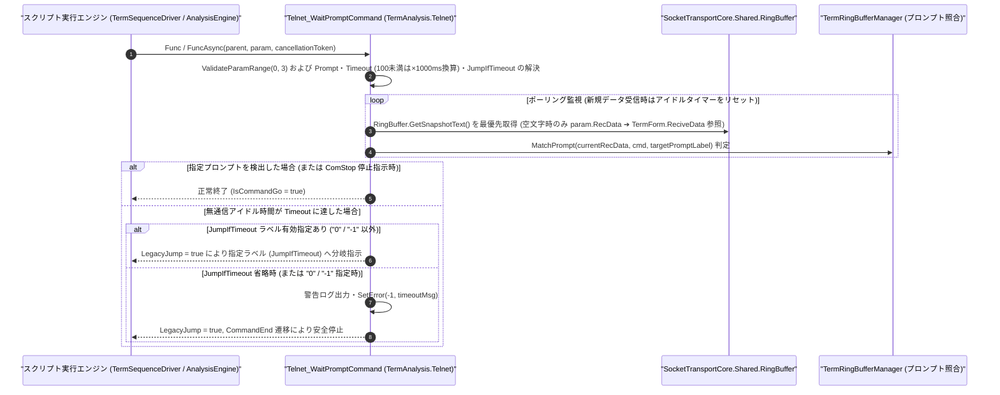

# コマンドリファレンス：Telnet_WaitPrompt

## 概要

**Telnet_WaitPrompt** は、Telnet（または Raw TCP ソケット）の非同期受信リングバッファ（`TermRingBufferManager`）を監視し、指定されたプロンプト文字列（ログインプロンプト・コマンドプロンプト・応答キーワード等）が受信されるまで待機するコマンドです。
タイムアウト発生時に指定ラベルへ自動分岐させる機能を備えています。

> 💡 **補足** : NVT フィルタ（`Telnet_Mode` の第 3 引数 `ON`）が有効な場合、Telnet 制御コード（IAC `0xFF` シーケンス）が除去された純粋なテキストストリームに対してパターンマッチングを行います。

---

## 💡 書式・パラメータ仕様

### コマンド構文

```csv
,SEQUENCE, [ステップキー], Telnet_WaitPrompt, "[Prompt]", "[TimeoutMsOrSec]", "[JumpIfTimeout]"
```

※ 第 1 引数に既存のステップキー（ジャンプ先）を指定した場合は、旧互換形式 `Telnet_WaitPrompt, #JumpIfTimeout#, "[TimeoutSec]", "[Prompt]"` としても解釈されます。

### パラメータ（引数）一覧

| 引数位置 | パラメータ名 | 必須/任意 | 型・制約 | 説明 |
| :---: | :--- | :---: | :--- | :--- |
| 第1引数 | `Prompt` | 任意 | 文字列 | 受信を待機するプロンプト文字列または登録プロンプトキー（例: `"login:"`, `"Password:"`, `"#"`）を指定します。省略または空文字の場合は、コマンドに登録済みの `Prompts` 定義一覧に一致する文字列を待機します（送信コマンドのエコーバック誤検知を防ぐため、先頭 1 行目をスキップした 2 行目以降の領域とバッファ全文の双方で部分一致照合 `MatchPrompt` を行います）。 |
| 第2引数 | `TimeoutMsOrSec` | 任意 | 数値（ミリ秒または秒） | 無通信アイドル待機時間を指定します。 **`100` 以上の値はミリ秒単位（ms）、`100` 未満の正数は秒単位（`× 1000` ms、最小 `50` ms）** として自動換算されます（例: `"5"` ➔ `5000` ms、`"5000"` ➔ `5000` ms）。省略時は UI 設定の `WaitPrompt` 秒数（UI 既定値 `3` 秒 ＝ `3000` ms、UI 未接続時は `10000` ms）が適用されます。新規データを受信するたびにタイマーはリセットされます。 |
| 第3引数 | `JumpIfTimeout` | 任意 | `#ラベル名#` / ステップキー | タイムアウト発生時にジャンプする遷移先ラベルを指定します。省略時（または `"0"` / `"-1"` 指定時）は警告ログおよび `SetError(-1, ...)` を記録し、`CommandEnd` へ遷移してシーケンスを安全に停止します。 |

---

## 🔄 特殊置換規約・分岐規約の適用

本コマンドの引数における特殊記法および解釈ルールです。
* **動的置換（`$`）** : 引数内で `$PARAMキー$` のように記述すると、実行時に変数プール（PARAM）の値へ動的置換されます。（適用可能な引数: 全引数対応）
* **ジャンプ先指定（`#`）** : タイムアウト発生時の遷移先ラベルを `#ラベル名#` の形式で指定できます。（適用可能な引数: `JumpIfTimeout` 引数）
* **共通コマンド指定（`@`）** : 本コマンドは外部マクロを呼び出さないため、共通コマンド呼び出し記法は適用されません。（適用可能な引数: 非適用）
* **カンマのエスケープ** : 通信条件文字列（例: `"9600,E,7,1"`）や複数データのカンマ区切り値を単一引数として渡す場合は、必ず `"..."` と二重引用符で囲んで記述します。
* **エイリアス（別名）** : なし（標準コマンド名 `Telnet_WaitPrompt` のみ。大文字・小文字は区別されません）

---

## 💡 動作例（正しい構文での記述例）

### スクリプト記述例

※COMMAND ブロック配下の子要素行（PARAM, SEQUENCE）は必ず行頭カンマから開始し、スペースインデントや行末コメント（`;`）は記述しないでください。

```csv
COMMAND, "SAMPLE_TELNET_WAITPROMPT", ""
,PARAM, "IDN_RES", Work, "SCPI識別応答", ""
,SEQUENCE, 010, Telnet_Open
,SEQUENCE, 020, Telnet_Send, "*IDN?"
; 5000ms（"5" でも同義）以内にプロンプト "SCPI>" が返らなければ #ERR_TIMEOUT# へジャンプ
,SEQUENCE, 030, Telnet_WaitPrompt, "SCPI>", "5000", #ERR_TIMEOUT#
,SEQUENCE, 040, Set_Data, "IDN_RES"
,SEQUENCE, 050, Telnet_Close
,SEQUENCE, 060, Exit
,SEQUENCE, #ERR_TIMEOUT#, Msg_Box, "機器からのSCPI応答がタイムアウトしました"
,SEQUENCE, 070, Telnet_Close
,SEQUENCE, 080, Exit
```

### 実行時の挙動・変数変化

* **実行前の状態** : Term 通信エンジンが初期化され、必要な通信パラメータおよび変数プール（`PARAM`）が準備されている状態。
* **実行後の状態** : `"*IDN?"` 送信後、無通信アイドル時間が 5,000ms に達するまで `"SCPI>"` の到着を待機します。時間内に受信されれば `Set_Data` へ進んで受信内容を変数 `IDN_RES` に取り込み、タイムアウトした場合は `#ERR_TIMEOUT#` ラベルへ分岐して安全にソケットを閉じます。

---

## 🔄 動作フロー（シーケンス図）



---

## 🚫 エラーハンドリング・安全設計（仕様制限）

1. **TCP リングバッファ優先参照・登録プロンプト連携・エコーバック誤検知防止** :
   - 監視ループでは `SocketTransportCore.Shared.RingBuffer.GetSnapshotText()` を最優先で参照し（空文字の場合のみ `param.RecData` ➔ `parent?.TermForm?.ReciveData` へフォールバック）、GUI 接続時でもシリアル用受信プロパティの空文字に阻害されず Telnet 受信データを確実に照合します。第 1 引数 `Prompt` 省略時はコマンド定義内の登録プロンプト群を検索し、先頭 1 行目をスキップした領域も併せて照合することでエコーバック行の誤検知を防ぎます（引数 4 個以上超過時は `ValidateParamRange(0, 3)` によりエラーコード `-10` で早期停止します）。
2. **アイドルタイムアウト方式とキャンセル即時応答** :
   - 応答データの連続受信中はタイマーが自動リセットされ、無通信状態が指定時間に達した時点でタイムアウトと判定します。待機中にユーザーから停止要求があった場合は `CancellationToken` により即座に待機を中断し、エラーコード `-2`（`SetErrorAndHalt(-2, ...)`）で安全に終了します。

---

## 🧪 ユニットテスト仕様

本コマンドクラス（`Telnet_WaitPromptCommand.cs`）に実装されている `RunUnitTest()` メソッドが検証するユニットテストの仕様です。

### テスト実行前提条件

* **実行トリガー** : `RunUnitTest()` メソッドの呼び出し
* **有効化条件** : システム全体の最小ログレベル（`ErrorLogger.MinimumLevel`）が `LogLevel.Test` であること（それ以外の場合は無効化ガードにより早期リターン）
* **検証結果出力** : `_log.LogTest` によるログ出力。検証失敗時は `_log.LogError`、予期せぬ例外発生時は `_log.LogCritical` で記録し、`finally` ブロックで `TermRingBufferManager.Instance.ClearBuffer()` および `SocketTransportCore.Shared.IsLoopbackMode` の復元を実行します。

### テストケース一覧

| No | テストカテゴリ | テスト条件（入力値） | 期待される結果（出力値） | 検証の目的 / 観点 |
| :---: | :--- | :--- | :--- | :--- |
| **1** | 正常系 | `IsLoopbackMode = true` 環境下でプロンプト `"LOGIN"`（`"login:"`）を登録し、`RecData = "Welcome to Linux\r\nlogin: "` に対して引数 `"LOGIN"`, `"200"` を指定して実行 | `!param.HasError` かつ `param.IsCommandGo == true`、`!param.LegacyJump` で待機解除・正常完了する | 受信データ内の登録プロンプト一致検出および正常通過の検証 |
| **2** | 異常系 | 過剰引数 4 個（`"LOGIN"`, `"50"`, `"JUMP_LBL"`, `"EXTRA_INVALID"`）および `Func(null, null)` を指定して実行 | 例外クラッシュせず `!invalidParam.IsCommandGo` で安全に実行拒否・早期リターンする | 引数上限（`ValidateParamRange(0, 3)`）違反および `null` パラメータに対する安全防御検証 |
