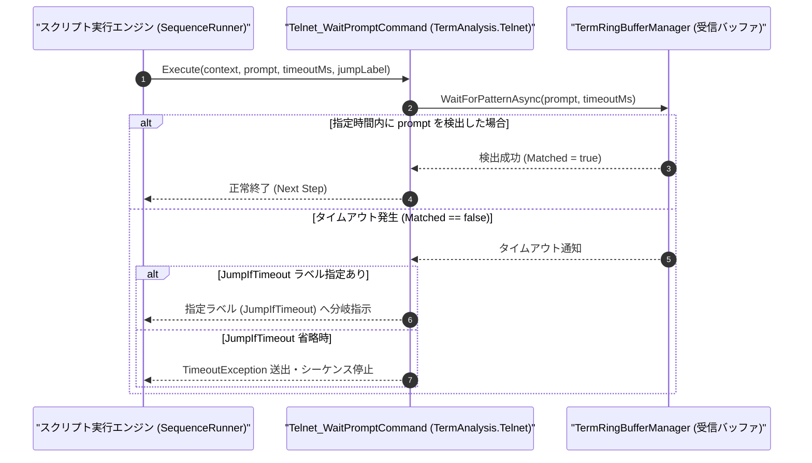

# コマンドリファレンス：Telnet_WaitPrompt

---

## 概要

**Telnet_WaitPrompt** は、Telnet（または Raw TCP ソケット）の非同期受信リングバッファ（`TermRingBufferManager`）を監視し、指定されたプロンプト文字列（ログインプロンプト・コマンドプロンプト・応答キーワード等）が受信されるまで待機するコマンドです。
タイムアウト発生時に指定ラベルへ自動分岐させる機能を備えています。

> 💡 **補足**: NVT フィルタ（`Telnet_Mode` の第 3 引数 `ON`）が有効な場合、Telnet 制御コード（IAC `0xFF` シーケンス）が除去された純粋なテキストストリームに対してパターンマッチングを行います。

---

## 💡 書式・パラメータ仕様

### コマンド構文

```csv
,SEQUENCE,Telnet_WaitPrompt, "<Prompt>", "[TimeoutMs: 10000]", "[JumpIfTimeout]"
```

### パラメータ（引数）一覧

| 引数位置 | パラメータ名 | 必須/任意 | 型・制約 | 説明 |
| :---: | :--- | :---: | :--- | :--- |
| 第1引数 | `Prompt` | **必須** | 文字列 | 受信を待機するプロンプト文字列または応答パターン（例: `"login:"`, `"Password:"`, `"#"`）を指定します。 |
| 第2引数 | `TimeoutMs` | 任意 | 整数（ミリ秒、既定値: `10000`） | 最大待機時間をミリ秒単位で指定します。省略時は `10000`（10秒）となります。 |
| 第3引数 | `JumpIfTimeout` | 任意 | ラベル名 / ステップ番号 | タイムアウト発生時にジャンプする遷移先ラベルを指定します。省略時はタイムアウト例外を送出して停止します。 |

---

## 🔄 特殊置換規約・分岐規約の適用

1. **変数展開（`$` / `@` / `#`）**:
   - 第 1 引数のプロンプト文字列や第 2 引数のタイムアウト値には変数を使用できます。
2. **タイムアウト分岐規約**:
   - 第 3 引数 `JumpIfTimeout` が指定されている場合、タイムアウト発生時に異常終了せず、指定されたラベルステップへ遷移します。

---

## 💡 動作例（正しい構文での記述例）

### スクリプト記述例

```csv
,SEQUENCE,Telnet_Open
,SEQUENCE,Telnet_Send, "*IDN?"
; 5秒以内に改行またはプロンプト "SCPI>" が返らなければ ERR_TIMEOUT へジャンプ
,SEQUENCE,Telnet_WaitPrompt, "SCPI>", "5000", "ERR_TIMEOUT"
,SEQUENCE,Set_Data, "@IDN_RES", "SBuf", "1"
,SEQUENCE,Telnet_Close
,SEQUENCE,Exit

:ERR_TIMEOUT
,SEQUENCE,Msg_Box, "機器からのSCPI応答がタイムアウトしました"
,SEQUENCE,Telnet_Close
,SEQUENCE,Exit
```

### 実行時の挙動・変数変化

1. `"*IDN?"` 送信後、最大 5,000ms の間 `"SCPI>"` の到着を待機します。
2. 時間内に受信されれば `Set_Data` へ進み、タイムアウトした場合は `:ERR_TIMEOUT` ラベルへ分岐して安全にソケットを閉じます。

---

## 🔄 動作フロー（シーケンス図）



---

## 🚫 エラーハンドリング・安全設計（仕様制限）

1. **空プロンプト指定の禁止**:
   - 第 1 引数 `Prompt` が空文字列の場合は、`ArgumentException` を送出して誤動作を防止します。
2. **相手ホストからの切断検知**:
   - 待機中にリモートホストから TCP セッションが切断（FIN / RST 受信）された場合は、タイムアウトを待たずに即座に切断検知または分岐処理へ移行します。

---

## 🧪 ユニットテスト仕様

### テスト実行前提条件
- **対象クラス**: `TermAnalysis.Telnet.Telnet_WaitPromptCommand`（`Telnet_WaitPromptCommand.cs`）
- **モック環境**: `TermRingBufferManager` に疑似受信データを非同期投入できるテストハーネスが構成されていること。

### テストケース一覧

| テストID | テスト観点 | 入力スクリプト | 期待される動作・検証項目 |
| :--- | :--- | :--- | :--- |
| `UT-TELNET-WAIT-01` | 正常系（プロンプト検出） | `,SEQUENCE,Telnet_WaitPrompt, "login:", "2000"` | バッファに `"login:"` が到着した時点で即座に待機完了し次ステップへ進むこと。 |
| `UT-TELNET-WAIT-02` | 正常系（タイムアウト分岐） | `,SEQUENCE,Telnet_WaitPrompt, "login:", "100", "ERR_LBL"` | 100ms 経過後に遷移先が `"ERR_LBL"` に設定されること。 |
| `UT-TELNET-WAIT-03` | 異常系（タイムアウト停止） | `,SEQUENCE,Telnet_WaitPrompt, "login:", "100"` | 第 3 引数省略時に 100ms 経過すると `TimeoutException` が送出されること。 |

