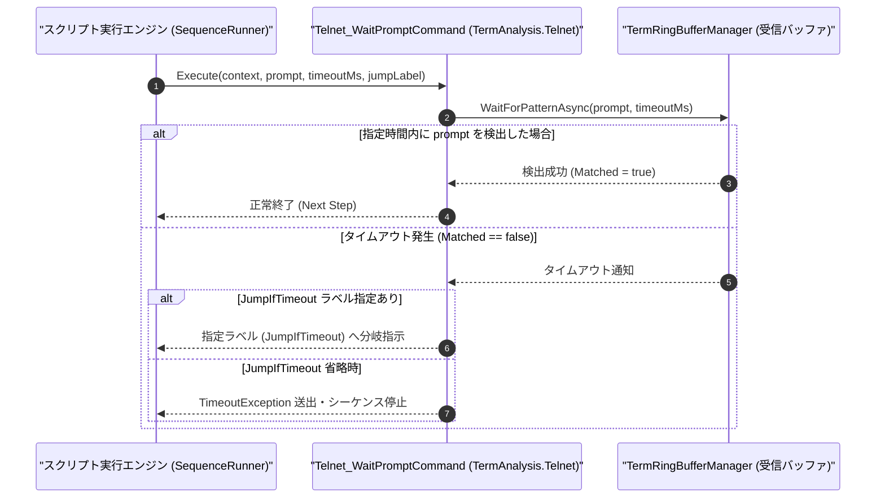

# コマンドリファレンス：Telnet_WaitPrompt

## 概要

**Telnet_WaitPrompt** は、Telnet（または Raw TCP ソケット）の非同期受信リングバッファ（`TermRingBufferManager`）を監視し、指定されたプロンプト文字列（ログインプロンプト・コマンドプロンプト・応答キーワード等）が受信されるまで待機するコマンドです。
タイムアウト発生時に指定ラベルへ自動分岐させる機能を備えています。

> 💡 **補足**: NVT フィルタ（`Telnet_Mode` の第 3 引数 `ON`）が有効な場合、Telnet 制御コード（IAC `0xFF` シーケンス）が除去された純粋なテキストストリームに対してパターンマッチングを行います。

---

## 💡 書式・パラメータ仕様

### コマンド構文

```csv
,SEQUENCE, [ステップキー], Telnet_WaitPrompt, "<Prompt>", "[TimeoutMs: 10000]", "[JumpIfTimeout]"
```

### パラメータ（引数）一覧

| 引数位置 | パラメータ名 | 必須/任意 | 型・制約 | 説明 |
| :---: | :--- | :---: | :--- | :--- |
| 第1引数 | `Prompt` | **必須** | 文字列 | 受信を待機するプロンプト文字列または応答パターン（例: `"login:"`, `"Password:"`, `"#"`）を指定します。 |
| 第2引数 | `TimeoutMs` | 任意 | 整数（ミリ秒、既定値: `10000`） | 最大待機時間をミリ秒単位で指定します。省略時は `10000`（10秒）となります。 |
| 第3引数 | `JumpIfTimeout` | 任意 | ラベル名 / ステップ番号 | タイムアウト発生時にジャンプする遷移先ラベルを指定します。省略時はタイムアウト例外を送出して停止します。 |

---

## 🔄 特殊置換規約・分岐規約の適用

本コマンドの引数における特殊記法および解釈ルールです。
* **動的置換（`$`）**: 引数内で `$PARAMキー$` のように記述すると、実行時に変数プール（PARAM）の値へ動的置換されます。（適用可能な引数: 全引数対応）
* **ジャンプ先指定（`#`）**: タイムアウト発生時の遷移先ラベルを `#ラベル名#` の形式で指定できます。（適用可能な引数: `JumpIfTimeout` 引数）
* **共通コマンド指定（`@`）**: 本コマンドは外部マクロを呼び出さないため、共通コマンド呼び出し記法は適用されません。（適用可能な引数: 非適用）
* **カンマのエスケープ**: 通信条件文字列（例: `"9600,E,7,1"`）や複数データのカンマ区切り値を単一引数として渡す場合は、必ず `"..."` と二重引用符で囲んで記述します。
* **エイリアス（別名）**: なし（標準コマンド名 `Telnet_WaitPrompt` のみ。大文字・小文字は区別されません）

---

## 💡 動作例（正しい構文での記述例）

### スクリプト記述例

※COMMAND ブロック配下の子要素行（PARAM, SEQUENCE）は必ず行頭カンマから開始し、スペースインデントや行末コメント（`;`）は記述しないでください。

```csv
COMMAND, "SAMPLE_TELNET_WAITPROMPT", ""
,SEQUENCE, 010, Telnet_Open
,SEQUENCE, 020, Telnet_Send, "*IDN?"
; 5秒以内に改行またはプロンプト "SCPI>" が返らなければ ERR_TIMEOUT へジャンプ
,SEQUENCE, 030, Telnet_WaitPrompt, "SCPI>", "5000", "ERR_TIMEOUT"
,SEQUENCE, 040, Set_Data, "@IDN_RES", "SBuf", "1"
,SEQUENCE, 050, Telnet_Close
,SEQUENCE, 060, Exit
,SEQUENCE, #ERR_TIMEOUT#, Msg_Box, "機器からのSCPI応答がタイムアウトしました"
,SEQUENCE, 070, Telnet_Close
,SEQUENCE, 080, Exit
```

### 実行時の挙動・変数変化

* **実行前の状態**: Term 通信エンジンが初期化され、必要な通信パラメータおよび変数プール（`PARAM`）が準備されている状態。
* **実行後の状態**: `"*IDN?"` 送信後、最大 5,000ms の間 `"SCPI>"` の到着を待機します。 時間内に受信されれば `Set_Data` へ進み、タイムアウトした場合は `:ERR_TIMEOUT` ラベルへ分岐して安全にソケットを閉じます。

---

## 🔄 動作フロー（シーケンス図）



---

## 🚫 エラーハンドリング・安全設計（仕様制限）

1. **空プロンプト指定の禁止**:
   - 第 1 引数 `Prompt` が空文字列の場合は、`ArgumentException` を送出して誤動作を防止します。
2. **相手ホストからの切断検知**:
   - 待機中にリモートホストから TCP セッションが切断（FIN / RST 受信）された場合は、タイムアウトを待たずに即座に切断検知または分岐処理へ移行します。

---

## 🧪 ユニットテスト仕様

本コマンドクラス（`Telnet_WaitPromptCommand.cs`）に実装されている `RunUnitTest()` メソッドが検証するユニットテストの仕様です。

### テスト実行前提条件

* **実行トリガー**: `RunUnitTest()` メソッドの呼び出し
* **有効化条件**: システム全体の最小ログレベル（`ErrorLogger.MinimumLevel`）が `LogLevel.Test` であること（それ以外の場合は無効化ガードにより早期リターン）
* **検証結果出力**: `_log.LogTest` によるログ出力。検証失敗時は `_log.LogError`、予期せぬ例外発生時は `_log.LogCritical` で記録し、`finally` ブロックで `TermRingBufferManager.Instance.ClearBuffer()` および `SocketTransportCore.Shared.IsLoopbackMode` の復元を実行します。

### テストケース一覧

| No | テストカテゴリ | テスト条件（入力値） | 期待される結果（出力値） | 検証の目的 / 観点 |
| :---: | :--- | :--- | :--- | :--- |
| **1** | 正常系 | `IsLoopbackMode = true` 環境下でプロンプト `"LOGIN"`（`"login:"`）を登録し、`RecData = "Welcome to Linux\r\nlogin: "` に対して引数 `"LOGIN"`, `"200"` を指定して実行 | `!param.HasError` かつ `param.IsCommandGo == true`、`!param.jump` で待機解除・正常完了する | 受信データ内の登録プロンプト一致検出および正常通過の検証 |
| **2** | 異常系 | 過剰引数 4 個（`"LOGIN"`, `"50"`, `"JUMP_LBL"`, `"EXTRA_INVALID"`）および `Func(null, null)` を指定して実行 | 例外クラッシュせず `!invalidParam.IsCommandGo` で安全に実行拒否・早期リターンする | 引数上限（`ValidateParamRange(0, 3)`）違反および `null` パラメータに対する安全防御検証 |
