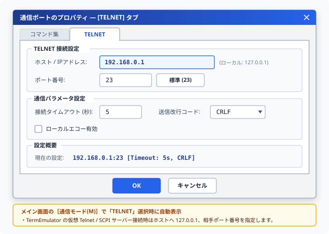
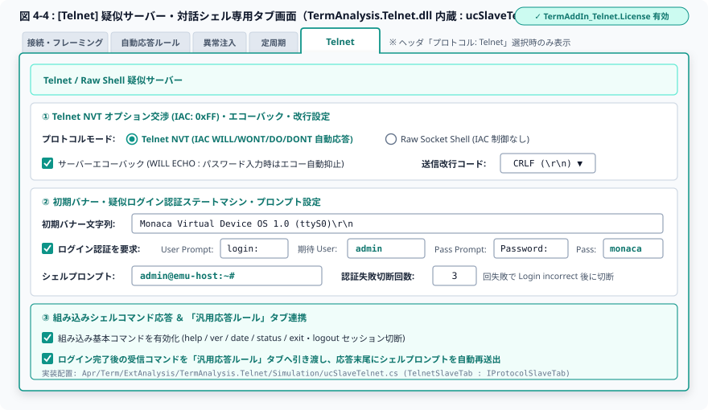

# Telnet（Telnet / TCP ソケット通信）アドイン取扱説明書

👉 [← TermAddIn_Telnet 製品トップに戻る](../README.md)  
👉 [← プロパティ設定画面取扱説明書（共通）](../プロパティ設定画面取扱説明書.Md) ／ [← TermEmulator 操作説明書（共通）](https://github.com/Monaca-App/TermEmulator/blob/main/Manual/TermEmulator操作説明書.Md) ／ [← マクロスクリプト取扱説明書（共通）](../マクロスクリプト取扱説明書.Md)

---

本書は、**TermAddIn_Telnet**（`TermAnalysis.Telnet.dll`：Telnet / Raw TCP ソケット通信エクステンション）の **取扱説明書 兼 機能解説書** です。Telnet 通信の基礎仕組み、プロパティ設定画面の **「TELNET」タブ**、**TermEmulator の `[Telnet]` 仮想サーバータブ**、および全 6 コマンドのリファレンスを 1 冊にまとめています。

* **必須拡張ライセンス**: **`TermAddIn_Telnet.License`** （組み込み先: `TermAnalysis.Telnet.dll`、`TermEmulator` と相互共用）


### 関連する公式規格・仕様書（外部リンク）
* [IETF RFC 854：Telnet Protocol Specification（公式規格書）](https://datatracker.ietf.org/doc/html/rfc854) — Telnet NVT（Network Virtual Terminal）および `IAC` オプション交渉の一次規格仕様書です。
* [Microsoft Learn：`System.Net.Sockets.TcpClient` クラス公式リファレンス（.NET Framework 4.8）](https://learn.microsoft.com/ja-jp/dotnet/api/system.net.sockets.tcpclient?view=netframework-4.8) — TCP ソケット接続基盤の公式仕様です。
---

## 目次

- [1. 機能概要と基礎知識（はじめての方へ）](#1-機能概要と基礎知識はじめての方へ)
- [2. プロパティ設定画面：「TELNET」タブの詳細](#2-プロパティ設定画面telnetタブの詳細)
- [3. TermEmulator 仮想サーバー設定：「[Telnet]」タブの詳細](#3-termemulator-仮想サーバー設定telnetタブの詳細)
- [4. マクロコマンド一覧（全 6 コマンド）](#4-マクロコマンド一覧全-6-コマンド)

---

## 1. 機能概要と基礎知識（はじめての方へ）

### 対応する機能の概要
**Telnet（Telnet / TCP ソケット通信）** アドインは、パソコンと外部機器を **LAN ケーブル（ネットワーク）** で繋ぎ、ログイン認証（`login:` / `Password:`）を伴う対話コマンドシェルや、汎用 TCP ソケット上の文字コマンド送受信・設定ファイル一括送信を行う通信機能です。
ルータ・スイッチ・Linux 組込ボード・LAN 変換器付き機器などに対応します。
※ LAN 計測器（SCPI / VXI-11 / HiSLIP 等）の専用制御には [LxiRaw](../LxiRaw/LxiRaw取扱説明書.Md) / [LxiVxi11](../LxiVxi11/LxiVxi11取扱説明書.Md) / [LxiHiSlip](../LxiHiSlip/LxiHiSlip取扱説明書.Md) アドインを使用してください。

### 機能の実現方法
* **RFC 854 Telnet NVT ＆ Raw TCP デュアルエンジン**: 標準 TCP ソケット上に Telnet 固有の制御コード（`IAC 0xFF` の `WILL/WONT/DO/DONT` オプション交渉）を自動応答・除去する NVT フィルタを搭載し、設定 1 つで標準 Telnet 機器にも生ソケット機器（NVT OFF）にも対応します。
* **プロンプト待機＆行間ディレイ付きファイル送信**: `Telnet_WaitPrompt` で `login:` や `#` を監視しながら自動ログインし、`Telnet_SendFile` でコンフィグファイルを 1 行ずつ指定ミリ秒間隔で安全に流し込めます。
* **仮想 Telnet サーバー連携**: `TermEmulator` の `[Telnet]` タブでログイン認証・プロンプト応答を模擬でき、実機ネットワークへ繋ぐ前に自動ログイン手順を検証できます。

### このアドインを選択することの利点
* **手作業の端末ログイン操作を完全自動化**: Tera Term 等で毎回手入力していたログイン・設定投入・状態確認を Excel ボタン 1 つで再現でき、入力ミスを防げます。
* **シリアル（`Comm`）と同じ操作感で LAN 移行**: コマンド体系（`Open` / `Mode` / `Send` / `SendFile` / `WaitPrompt` / `Close`）が `Comm` と共通のため、シリアル機器から LAN 機器へ置き換えても手順をそのまま転用できます。
* **行間ディレイによる設定漏れ防止**: 処理速度の遅いネットワーク機器へ大量の設定行を送る際も、行間待ち時間を入れることで取りこぼしなく確実に投入できます。

### 設定の妥当性を判断するためのチェックポイント
ネットワーク通信では、**「相手の住所（IP アドレス）」と「部屋の番号（ポート番号）」** の 2 つを正しく合わせることが最重要です。

| 確認項目 | 項目の意味 | 設定値の目安・確認方法 |
| :--- | :--- | :--- |
| **ホスト / IP アドレス** | ネットワーク上の「相手の住所」（例: `192.168.0.10`） | 相手機器の設定画面や本体パネルで確認します。パソコンと機器の IP は **先頭 3 つの数字（例: `192.168.0.*`）を同じグループ** に揃える必要があります。 |
| **ポート番号** | 相手機器側の通信ポート番号（例: `23`） | 標準の Telnet ログイン機器は **`23`** です。独自の LAN 機器はマニュアル指定の番号（例: `2323` 等）を入れます。 |
| **NVT フィルタ（IAC）** | Telnet 固有の制御用ネゴシエーション信号（`0xFF`）を自動処理する機能 | ルータや Linux 等の標準 Telnet 機器は **`ON`** にします。単なる文字送受信だけの機器（Raw TCP）で意図しない制御文字が混入する場合は **`OFF`** にします。 |
| **改行コード / プロンプト** | 命令の終わり合図と、相手が「次の命令をどうぞ」と返す目印 | 多くの Telnet 機器は **`CRLF`** です。ログイン自動化では画面に出る `login:` や `#` を `Telnet_WaitPrompt` で待ち受けます。 |

### 通信の仕組み解説（プロトコル構造と代表的なトラブル事例・対処法）
Telnet 通信は、TCP 接続の直後に以下の 3 段階で進みます。

```text
① TCP 接続確立 (IP:23) ➔ ② 制御用オプション交渉 (IAC 0xFF: WILL/DO 等を自動応答) ➔ ③ ログイン ＆ コマンド対話 (login: ➔ Password: ➔ #)
```

* **事例①：接続直後に意図しない制御文字が表示される** ➔ 相手が標準 Telnet サーバーなのに NVT フィルタが OFF の場合、または逆に Raw TCP 機器なのに NVT フィルタが ON の場合に発生します。`Telnet_Mode` の第 3 引数（`ON` / `OFF`）を切り替えてください。
* **事例②：パスワード送信後に先に進まない** ➔ `Telnet_WaitPrompt` で待っているプロンプト文字列（例: `#` や `>`）が、実際の機器表示と 1 文字違う（空白の有無や大文字・小文字）ことが原因です。
* **事例③：そもそも接続できない（タイムアウト）** ➔ PC と相手機器のサブネット（IP の先頭 3 組）が一致しているか、および Windows ファイアウォールやルータ側で TCP ポート `23` が許可されているか確認してください。

---

## 2. プロパティ設定画面：「TELNET」タブの詳細



メイン画面で **`TELNET`** モードを選択しているときに表示され、[`Telnet_Open`](./Telnet_Open.Md) 等のネットワーク接続条件を設定します（`Telnet` / `ModeSetting` セクションへ保存）。

| 項目名 | 設定値・範囲（既定値） | 詳しい意味と設定のポイント |
| :--- | :--- | :--- |
| **`ホスト / IP アドレス`** | IPv4 アドレスまたはホスト名（既定 `192.168.0.1`） | 接続先機器の IP アドレスを指定します。同一 PC 上の TermEmulator（SCPI 計測器や Telnet 仮想サーバー）へ接続する場合は **`127.0.0.1`** を入力します。 |
| **`ポート番号`** | `1`〜`65535`（既定 `23`、`[ 標準 (23) ]` ボタン付） | Telnet 標準ポートは `23` です。SCPI 計測器や生ソケット機器の場合は相手機器のポート番号（例: `5025`、`2323`）を入力します。 |
| **`タイムアウト`** | `1`〜`60` 秒（既定 `5` 秒） | 接続確立および応答待機のタイムアウト秒数です。 |
| **`改行コード`** | `CRLF`（既定） / `CR` / `LF` | コマンド送信時に末尾へ付与する改行コードを選択します。 |
| **`ローカルエコー`** | チェックボックス（ON / OFF） | 送信文字をローカル表示するかどうかを切り替えます。 |

---

## 3. TermEmulator 仮想サーバー設定：`[Telnet]` タブの詳細

* **主な用途**: ネットワーク機器（ルータ・スイッチ・Linux 組込ボード等）の Telnet ログイン認証および対話コマンドシェルの模擬。



| 設定区分 | 設定項目 | 設定値・範囲（既定値） | 詳しい動作と設定のポイント |
| :--- | :--- | :--- | :--- |
| **① NVT・エコー** | **モード** | `Telnet NVT (IAC 自動応答)` / `Raw Socket Shell (IAC なし)` | 標準 Telnet クライアントと接続する場合は `Telnet NVT` を選びます（`IAC 0xFF` の `WILL/WONT/DO/DONT` オプション交渉を自動応答します）。生ソケット対話の場合は `Raw Socket Shell` を選びます。 |
| | **サーバーエコー / 改行コード** | エコー ON・OFF / `CRLF`・`CR`・`LF` | サーバーエコーを ON にすると入力文字をクライアントへエコーバックします（ **パスワード入力中はセキュリティ保護のため自動的にエコーを抑止** します）。 |
| **② バナー・ログイン** | **初期バナー / 認証要求** | ウェルカム文字列、`login:` / `Password:` 要求 ON・OFF | 接続直後に表示するバナー文字列と、ログイン認証を要求するかどうかを設定します。 |
| | **期待ユーザー名 / パスワード / 失敗回数** | ユーザー名（既定 `admin`）、パスワード（既定 `monaca`）、失敗切断回数（既定 `3`） | 認証失敗時の再入力および指定回数失敗後の自動切断挙動を再現できます。 |
| | **シェルプロンプト** | 文字列（例: `admin@emu-host:~# `） | ログイン成功後および各コマンド応答の末尾に表示するプロンプト文字列を指定します。`Telnet_WaitPrompt` のテストに最適です。 |
| **③ シェル・ルール連携** | **組み込みコマンド / ルール連携** | `help` / `ver` / `date` / `status` / `exit`、`自動応答ルール連携` | 組み込みコマンドの応答を有効化できます。さらに **`自動応答ルール連携`** を ON にすると、ログイン後に受信した任意の独自コマンドを基本タブ②「自動応答ルール」で評価し、応答の末尾へシェルプロンプトを自動再送出できます。 |

---

## 4. マクロコマンド一覧（全 6 コマンド）

* **[Telnet_Open](./Telnet_Open.Md)** / **[Telnet_Close](./Telnet_Close.Md)**
  * **概要**: 指定ホスト（または UI 設定）の IP アドレス・TCP ポートへソケット接続を排他確立（`Telnet_Open`、他ドメイン稼働時は自動クローズ切替）、または切断・解放（`Telnet_Close`）します。
  * **書式**:  
    `,SEQUENCE, [ステップキー], Telnet_Open, "[ホストIP(任意)]", "[ポート番号(任意)]", "[接続タイムアウトms(任意)]"`  
    `,SEQUENCE, [ステップキー], Telnet_Close`
* **[Telnet_Mode](./Telnet_Mode.Md)**
  * **概要**: 送信終端デリミタ（`"TXCRLF"` / `"TXCR"` / `"NON"`；※LF 単体で送信する場合は `Telnet_Send` の改行引数に `"LF"` を指定）、受信データモード（`"ASCII"` / `"BIN"`）、および Telnet NVT 制御コード（`IAC: 0xFF`）ネゴシエーションフィルタ（`"ON"` / `"OFF"`。Raw TCP SCPI 機器接続時は `"OFF"` 推奨）を設定します。
  * **書式**: `,SEQUENCE, [ステップキー], Telnet_Mode, "[送信デリミタ]", "[データモード]", "[NVTフィルタ(ON/OFF)]"`
* **[Telnet_Send](./Telnet_Send.Md)**
  * **概要**: Telnet / TCP ソケットへコマンド文字列（または通信エラー確認付きファイル）を送信します（0〜3 引数）。通常送信時は第 2 引数に `Sprintf` 書式または改行指定（`"CRLF"` / `"CR"` / `"LF"` / `"NONE"`）、第 3 引数に改行指定を渡せます。第 2 引数 `"FILE"` 指定時は第 3 引数の格納先キーへ通信エラー状態（`"CLR"` / `"SET"`）を格納します。
  * **書式**: `,SEQUENCE, [ステップキー], Telnet_Send, "[送信文字列またはファイルパス(任意)]", "[Sprintf書式 / 改行指定 / FILE(任意)]", "[改行指定またはエラー格納先キー(任意)]"`
* **[Telnet_SendFile](./Telnet_SendFile.Md)**
  * **概要**: 外部コンフィグ・スクリプトファイルを読み込み、Telnet ソケットへ逐次送信します。第 2 引数には進捗ダイアログ抑止（`"NP"` / `"0"` / `"false"`）または **行間ミリ秒ディレイ数値（例: `"50"`）** を指定可能です。
  * **書式**: `,SEQUENCE, [ステップキー], Telnet_SendFile, "[ファイルパス]", "[NPまたは行間遅延ms(任意)]", "[エラークリア(任意)]"`
* **[Telnet_WaitPrompt](./Telnet_WaitPrompt.Md)**
  * **概要**: ログインプロンプト（`login:` / `Password:`）やシェルプロンプト（`#` / `$` / `>`）の受信をアイドルリセット方式で非同期監視し、タイムアウト時は指定ラベルへ分岐します（第 1 引数省略可、`100` 未満のタイムアウト指定は `× 1000` ms 秒換算）。
  * **書式**: `,SEQUENCE, [ステップキー], Telnet_WaitPrompt, "[待機プロンプト文字列(任意)]", [タイムアウト(msまたは100未満秒)], [タイムアウト時ジャンプ先ラベル(任意)]`
